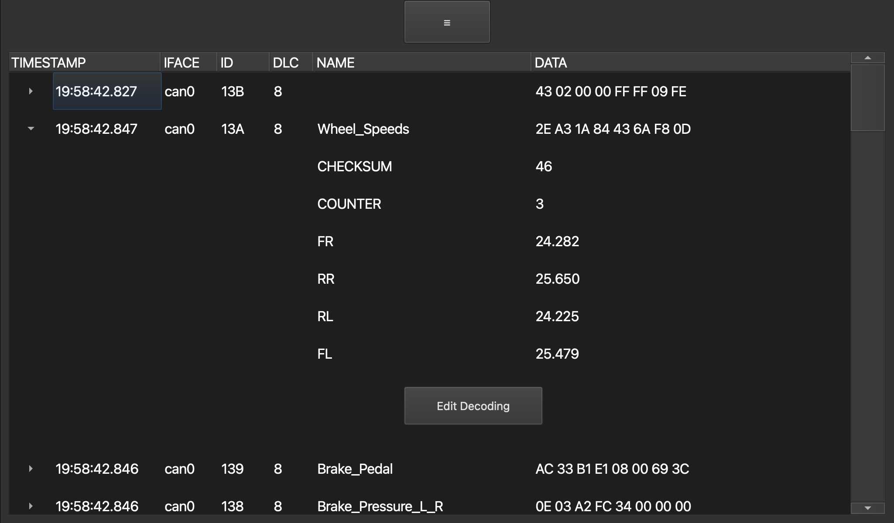
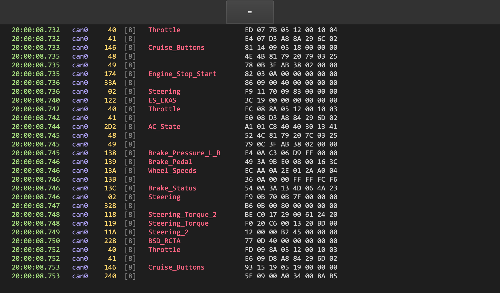
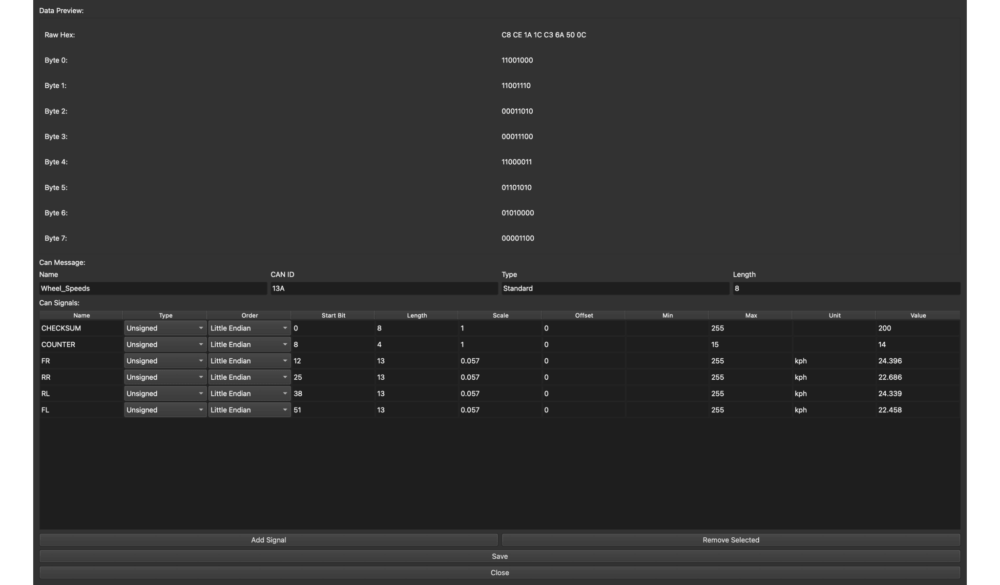
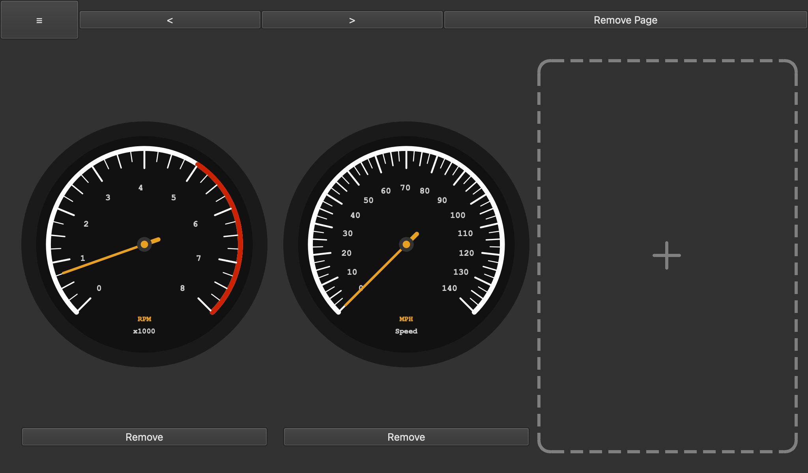

# CanGauge

A touchscreen app that connects to a vehicle's CAN bus, decodes the raw frames, and lets you build your own gauge pages from the decoded signals. It runs on a Raspberry Pi with a CAN HAT and a 7" touchscreen, and it's currently running in a project car.

<!-- TODO: add a photo of the gauges running in the car -->
<!--  -->

Status: work in progress. CanGauge is built around my own setup and isn’t a general-purpose tool yet. Some settings that should be configurable are still hardcoded. For example, the bitrate (500 kbps), the CAN channel and the DBC file are all set in main.py. Making these configurable in the app is next on the list.

## Features

- **Live CAN table.** Every arbitration ID seen on the bus, with its raw data updating in real time. Expand a row to see that frame's decoded signals and their current values.
- **DBC decoding.** Frames are decoded with [cantools](https://github.com/cantools/cantools) using DBC files.
- **Decode in the app.** If an ID isn't in the DBC, you can define a signal by hand (start bit, length, byte order, scale, offset) and see it decoded live, without changing the DBC file.
- **CAN stream view.** A scrolling view of incoming frames.
- **Custom gauges.** Turn any signal into a gauge:
  - **Needle gauge**: a round dial with colored warning/danger zones, tick marks and a digital readout
  - **Bar gauge**: a vertical bar with ticks, label and value
  - **Gauge presets** (for example Tire Pressure or Engine Temp) that fill in ranges, units and warning levels for you
- **Gauge layouts.** Pages are built from layout presets, such as two large gauges, two large gauges plus a row of small gauges, or two large gauges plus a bar gauge. Swipe or switch between several pages.
- **Saved layouts.** Gauge pages and their gauges are saved to JSON and restored on the next launch.
- **Demo mode.** Replays a recorded CAN log on a loop, so you can test the app without a car.
- **On-screen keyboard.** Uses Qt Virtual Keyboard for text entry on the touchscreen.

## Screenshots

| CAN table | CAN stream |
|---|---|
|  |  |

| Decoding a signal | Gauge page |
|---|---|
|  |  |

## Hardware

| Part | Notes |
|---|---|
| Raspberry Pi 4B | Runs Raspberry Pi OS |
| Waveshare 2-CH CAN HAT | Two MCP2515 controllers over SPI (`can0`, `can1`) |
| Raspberry Pi 7" touchscreen | Connects over DSI, so it doesn't conflict with the HAT's GPIO pins |
| OBD-II pigtail cable | Male OBD-II connector with bare wires |

### Wiring (OBD-II port → HAT)

| OBD-II pin | Signal | HAT terminal |
|---|---|---|
| 6 | CAN High | CAN0_H |
| 14 | CAN Low | CAN0_L |

> **Note:** Disable the HAT's 120 Ω termination jumper. The car's bus is already terminated, and a second terminator can kill the signal.

## Pi setup

### 1. Enable SPI and the MCP2515 overlays

Add the following to `/boot/firmware/config.txt` (`/boot/config.txt` on older Raspberry Pi OS), under `[all]`:

```
dtparam=spi=on
dtoverlay=mcp2515-can1,oscillator=16000000,interrupt=25,spimaxfrequency=2000000
dtoverlay=mcp2515-can0,oscillator=16000000,interrupt=23,spimaxfrequency=2000000
```

Reboot, then check that both controllers came up:

```bash
dmesg | grep -i mcp
# mcp251x spi0.0 can0: MCP2515 successfully initialized.
# mcp251x spi0.1 can1: MCP2515 successfully initialized.
```

### 2. Test the bus

```bash
sudo apt install can-utils
sudo ip link set can0 up type can bitrate 500000
candump can0
```

With the car's ignition on, you should see frames streaming. If nothing shows up, check the termination jumper, check that CAN-H and CAN-L aren't swapped, and try `bitrate 250000`.

## Installation

```bash
git clone <repo-url>
cd CanGauge
python3 -m venv .venv
source .venv/bin/activate
pip install PyQt5 cantools "python-can==4.3.1"
```

You'll also need Qt Virtual Keyboard for the on-screen keyboard (on Raspberry Pi OS, the `qtvirtualkeyboard-plugin` package).

## Usage

Run from the `can_gauge_app/` directory.

**Live, on the car:**

```bash
sudo python main.py
```

The app brings up `can0` at 500 kbps itself, which is why it needs root.

**Demo mode (no car needed):**

Running on a Mac or PC: CanGauge is designed for the Raspberry Pi 7" touchscreen (800×480), but demo mode runs fine on macOS or a desktop to try out the UI. Live mode needs SocketCAN, which is Linux-only, so on a Mac use python main.py test

```bash
python main.py test          # replay the demo log
python main.py test 200      # replay with a 200 ms interval between messages (minimum 100)
```

**DBC file:** the app loads the DBC path set in `main.py`. Point it at the DBC for your vehicle.

**Bitrate and channel:** change `bitrate` and `using_can0` at the top of `main.py`.

## Project structure

```
can_gauge_app/
├── main.py                  # entry point: sets up the bus or demo worker, DBC, and pages
├── can_worker/
│   └── worker.py            # QThread that reads from SocketCAN and emits batched frames
├── demo/
│   └── demo_worker.py       # replays a recorded CAN log on a loop
└── ui/
    ├── shell.py             # main window and page navigation
    ├── gauge_widgets/       # Gauge base class, NeedleGauge, BarGauge
    └── pages/
        ├── can_table/       # live ID table with expandable signal rows
        ├── can_stream/      # scrolling frame view
        └── gauge_page/      # gauge pages, layout presets, save/load
```

## How it works

```
can0 (SocketCAN) → CANWorker (QThread) → batched frames → active page → cantools decode → table / gauges
```

- **Reading** happens on a background `QThread` using python-can over SocketCAN, so the UI thread never blocks on the bus.
- **Batching.** A car bus can carry hundreds of frames per second, far faster than anyone can read a table. The worker keeps only the latest frame per ID and emits a batch on a timer, which cut CPU use on the Pi a lot compared with emitting a signal for every frame.
- **Routing.** Only the page currently on screen receives frames, so hidden pages don't waste time decoding.
- **Decoding** uses cantools: `db.decode_message(frame_id, data)` returns a dict of signal values. Hand-defined signals decode the same way through a temporary `Message` object, so the DBC on disk is never modified.
- **Rendering.** Gauges are custom `QWidget`s drawn with `QPainter`. Table updates are batched with sorting turned off, and the stream avoids HTML formatting, both of which were expensive on the Pi.

## Safety

CanGauge only **reads** from the bus. It never transmits to the car. Sending frames onto a vehicle bus can affect real modules, so test any future send features on a bench first.

## Roadmap

- [ ] Control features such as climate (sending frames, bench-tested first)
- [ ] Support for EV-conversion classic cars (battery SOC, motor and controller temps, BMS faults)
- [ ] Clean power-down handling, since cars cut power abruptly and SD cards corrupt easily
- [ ] Possible port to STM32 + LVGL with FreeRTOS

## Built with

- [PyQt5](https://pypi.org/project/PyQt5/)
- [python-can](https://github.com/hardbyte/python-can)
- [cantools](https://github.com/cantools/cantools)
- [opendbc](https://github.com/commaai/opendbc) for the Subaru DBC

## Author

Owen Schardt
